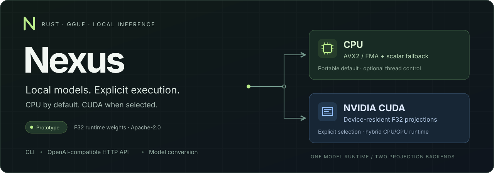
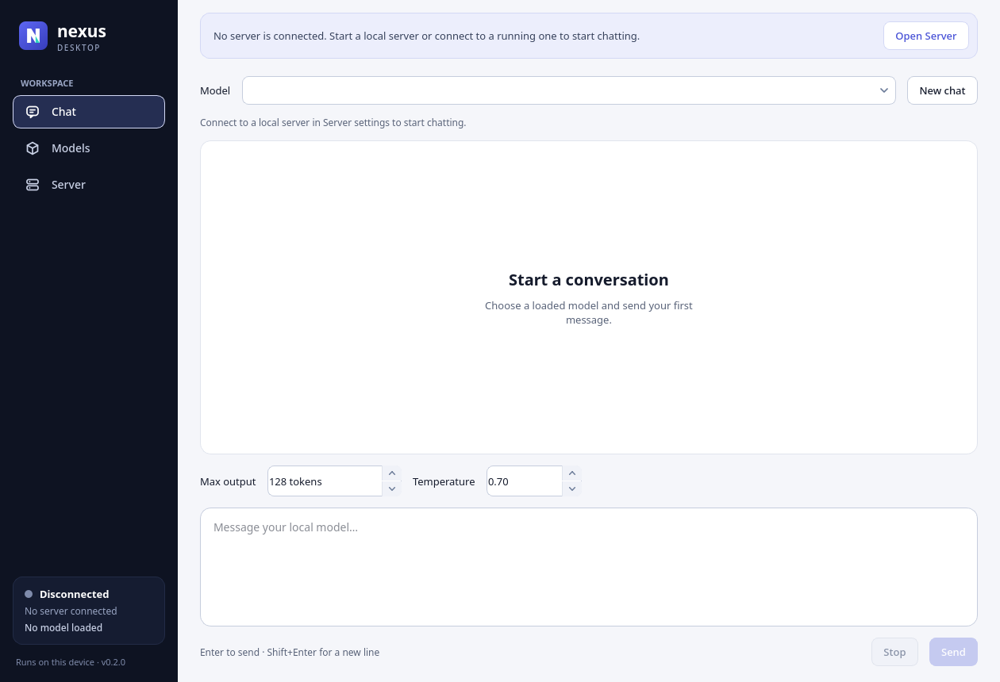
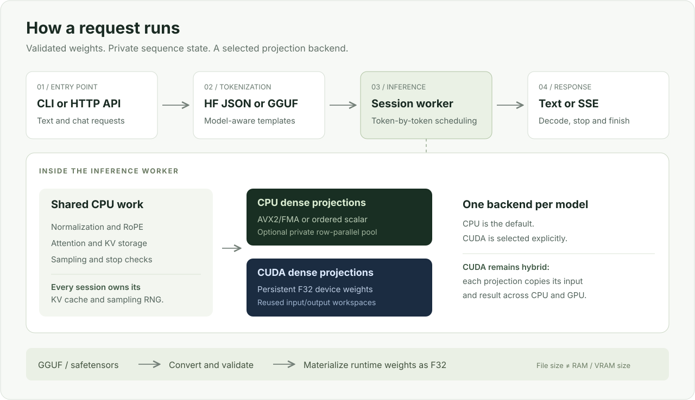

# Nexus

A Rust inference runtime for local **LLaMA-style GGUF models**, with a native Linux desktop manager, a CLI, an OpenAI-compatible HTTP API and a safetensors-to-GGUF converter.

CPU is the default. Supported x86 processors use runtime-selected AVX2/FMA projections; other processors use the portable scalar path. NVIDIA CUDA is an explicit option, with device-resident F32 weights and reusable transfer workspaces.

**Status:** working prototype · **Rust:** 1.88+ · **License:** Apache-2.0

[Quick start](#quick-start) · [Desktop](#desktop) · [Architecture](#architecture) · [Capabilities](#capabilities) · [HTTP API](#http-api) · [Benchmarks](#benchmarks) · [Development](#development)

For the Linux desktop launcher, Arch Linux installation and packages, see [Linux desktop](docs/linux-desktop.md). Recorded test configurations and measurements live in [validation notes](docs/validation.md).

## Quick start

### 1. Build the CPU tools

Install Rust 1.88 or newer, CMake, a C++ compiler, libclang, pkg-config and the platform TLS development libraries. Nexus builds native llama.cpp for GGUF vocabulary handling; you do not need a separate llama.cpp installation.

<details>
<summary>Native build prerequisites on Linux and macOS</summary>

Ubuntu / Debian:

```bash
sudo apt-get update
sudo apt-get install -y g++ cmake clang libclang-dev pkg-config libssl-dev
```

macOS with Homebrew:

```bash
brew install cmake llvm pkg-config
export LIBCLANG_PATH="$(brew --prefix llvm)/lib"
```

For Arch Linux and desktop packaging, follow the [Linux desktop guide](docs/linux-desktop.md).

</details>

```bash
cargo build --release --workspace --locked
```

The default build needs neither an NVIDIA driver nor Apple libraries on Linux.

### 2. Run a supported model

Use a LLaMA-architecture GGUF with a complete tokenizer. `model.gguf` below is your local model file.

```bash
./target/release/nexus info --model model.gguf

./target/release/nexus run \
  --model model.gguf \
  --prompt "The capital of France is" \
  --ctx-size 512 \
  --max-tokens 32 \
  --kv-quant none
```

`none` keeps the KV cache in floating point, which is useful as a correctness and performance reference. Low-bit KV formats are also available. Runtime weights are always **F32**, including when the source GGUF is quantized; file size does not describe required RAM or VRAM.

CPU execution defaults to one thread. You can set a per-backend limit with `--threads 2` or `--threads 4`, up to the machine's available CPU count. Small projections stay serial to avoid thread-pool overhead. CUDA rejects this CPU-only option.

### 3. Enable NVIDIA CUDA, if needed

```bash
cargo build --release --features cuda --locked --bins

./target/release/nexus run \
  --model model.gguf \
  --backend cuda \
  --prompt "The capital of France is" \
  --ctx-size 512 \
  --max-tokens 32 \
  --kv-quant none
```

CUDA loads the NVIDIA driver dynamically and uses the checked-in PTX. The kernel targets SM 8.0 or newer, and the driver must support PTX 9.4. A CUDA toolkit is needed to regenerate kernels or run Compute Sanitizer; ordinary builds do not invoke NVCC or NVRTC.

Explicit CUDA selection returns an error if the device or kernel fails. It never silently switches to CPU.

## Desktop

Nexus Desktop is a native Qt server manager for Linux. Choose a model and CPU/CUDA backend, start or stop your local server, manage model loading and inspect status, metrics and bounded logs. It can also attach to an existing loopback server without taking ownership of that process.



The interface is in Turkish. The screenshot shows the actual application's initial state; no model is running. Arch Linux packages and a GUI-only Debian package are described in [Linux desktop installation](docs/linux-desktop.md). The desktop app manages the server; it is not a chat client or a model downloader.

## Architecture



Both backends share the model loader, tokenizer, generation logic and session worker. Each session has its own KV cache and sampling RNG. The worker interleaves prefill and decode by token; model changes wait for active inference rather than switching weights midway through a sequence.

| Execution path | Dense projections | Everything around the projections |
| --- | --- | --- |
| **CPU** | Runtime-selected AVX2/FMA, with scalar fallback; optional private thread pool for large matrices | CPU |
| **NVIDIA CUDA** | Persistent F32 device weights, reused input/output workspaces, GPU matvec kernels | Attention, normalization, RoPE, sampling and KV storage remain on CPU |

CUDA is a **hybrid execution path**. Each projection still copies its input and result between CPU and GPU. This is not fused GPU batching or GPU paged attention. Scheduler page IDs account for requests; session caches own the actual KV tensors. The standalone memory-pool module is bookkeeping.

## Capabilities

| Area | Implemented behavior |
| --- | --- |
| **Models** | LLaMA architecture, GQA, SwiGLU and unscaled full-head RoPE. Unsupported architectures and scaled RoPE fail loading. |
| **Weight readers** | F32, F16, BF16, Q8_0, Q4_0, Q4_K and Q2_K payloads; materialized as F32 at runtime. |
| **Tokenizers** | Embedded Hugging Face tokenizer JSON, or original GGUF vocabularies executed by native llama.cpp. |
| **Chat templates** | Model Jinja templates, special-token context, named `default` templates and Python-compatible string/JSON behavior. Template errors are returned. |
| **Generation** | Greedy, temperature, top-p, top-k, repetition penalty, per-session seed, multiple EOS/EOT IDs and decoded-text stop strings. |
| **Serving** | Chat/text completions, SSE, bounded admission and stream buffers, model lifecycle, health and metrics. |
| **Conversion** | Safetensors/MLX-style shards to GGUF, with tokenizer/configuration import and supported file quantization. |
| **Other devices** | Metal device probing is optional. Metal, Vulkan and WebGPU inference are unavailable. |

A successful load means required tensors, dimensions, finite values, context and tokenizer have been validated. There is no synthetic inference fallback. An invalid replacement preserves the serving model. Tied embeddings are used only when a separate output head is absent; a present but unsupported head is an error.

Tokenizer compatibility and inference compatibility are separate. Tests with Qwen2.5 or Llama-3 tokenizer assets do not imply support for every corresponding model architecture.

### Convert a model

```bash
./target/release/nexus-convert \
  --input path/to/hf-model-directory \
  --output model.gguf \
  --quant f32
```

Use the converter's `--quant` option for the **file** format. `run --weight-quant` accepts only `FP32`, the implemented runtime storage format.

Include `tokenizer.json` and the source tokenizer, model and generation configuration files in the input directory. Chat templates are imported from `chat_template.jinja`, `chat_template.json`, or `tokenizer_config.json`, in that order. Named template collections need a `default` entry. Embedded HF JSON is authoritative in Nexus; conversion does not promise identical tokenizer behavior in other GGUF runtimes.

**Older Nexus conversions:** regenerate files produced with incompatible GGUF dimensions or Q/K RoPE layout. Older Q2_K/Q4_K outputs also used an incompatible bit layout. Regenerate from the original source model; Nexus does not guess a migration.

<details>
<summary>Model loading, tokenization and download details</summary>

- Models without a complete tokenizer fail by default. `--allow-byte-tokenizer` is only for synthetic fixtures.
- Saved tokenizer padding and truncation settings are disabled. The inference context budget controls prompt length.
- Raw text prompts add model special tokens. Rendered chat prompts do not add a second BOS.
- An optional `max_loaded_tensor_elements` cap must fit every required tensor.
- CUDA replacement temporarily needs room for both models so a failed validation/upload can preserve the original. Insufficient memory is an error.
- Downloads use temporary files and publish only after the stream and advertised length checks succeed. A `.nexus-download.json` receipt records URL, size and SHA-256; cache reuse rehashes the file.
- Download a specific file with `nexus download --model owner/repository/path/to/file --output models`; nested filenames are preserved.
- A download receipt detects local corruption. It is not a publisher signature or a check for updates to remote `main`. Files without a receipt are downloaded again; failed downloads preserve an existing destination and remove temporary files.

</details>

## HTTP API

Start a local server:

```bash
./target/release/nexus-server \
  --model model.gguf \
  --host 127.0.0.1 \
  --port 8080 \
  --batch-size 4
```

Add `--backend cuda` when using a CUDA-enabled build. The default listener is loopback. Authentication, CORS and request limits are configured through `NEXUS_API_KEY`, `NEXUS_CORS_ORIGIN` and `NEXUS_RATE_LIMIT_PER_MINUTE`, or the matching CLI flags.

Find the served model's `id`, then use it in a request:

```bash
curl http://127.0.0.1:8080/v1/models

curl http://127.0.0.1:8080/v1/chat/completions \
  -H 'Content-Type: application/json' \
  -d '{
    "model": "<served-model-id>",
    "messages": [{"role": "user", "content": "Explain KV caching briefly."}],
    "max_tokens": 64,
    "stream": true
  }'
```

When authentication is enabled, add `Authorization: Bearer <api-key>` or `x-api-key`.

| Method | Endpoint | Purpose |
| --- | --- | --- |
| POST | `/v1/chat/completions` | Chat completion, optional SSE |
| POST | `/v1/completions` | Text completion, optional SSE |
| GET | `/v1/models` | Served model list |
| GET | `/v1/model` | Effective model, tokenizer and backend configuration |
| POST | `/v1/model/load` | Validate and install a model |
| POST | `/v1/model/reload` | Reload the last loaded model |
| POST | `/v1/model/unload` | Unload without stopping the server |
| GET | `/v1/backends` | Implemented backend capabilities |
| GET | `/health` | Model and backend health |
| GET | `/metrics` | Runtime, scheduler and GPU counters |

Generation and device probing run outside Tokio's reactor threads. SSE suppresses partial stop strings and incomplete UTF-8, and disconnected clients are cleaned up. Decoders that can revise previous text buffer output until completion; this includes native Llama-3 BPE cleanup and complex HF decoder sequences. Unexpected revisions of already delivered text produce a stream error.

Rate limits use the TCP peer address and ignore client-supplied forwarding headers. Behind a reverse proxy, clients share its bucket; configure client-level limits at the proxy.

## Benchmarks

Use release builds and explicit settings. CPU example:

```bash
./target/release/nexus bench \
  --model model.gguf --backend cpu-simd --threads 1 --kv-quant none \
  --prompt-lens 32,128 --max-tokens 32 \
  --warmup 3 --iterations 10 --json
```

For CUDA, use `--backend cuda` and omit `--threads`. For CPU scaling, repeat with supported thread limits such as `2` and `4`.

The JSON records the model SHA-256, selected kernel and CPU thread limit, backend/KV configuration, actual generated token count, separate prefill and decode times, first visible token latency and nearest-rank p50/p95. Warmup runs are excluded. Sampling is deterministic (`temperature=0`, `seed=42`), and EOS can shorten a run.

Inputs are synthetic valid vocabulary IDs, so this measures execution rather than language quality. Prefill includes session allocation; generation excludes model loading. Hashing the model before measuring load time can warm the filesystem cache. This is a single-session measurement, not a concurrent HTTP capacity benchmark.

For a projection-only development experiment:

```bash
cargo run --release --locked --example cpu_matvec_bench -- \
  --threads 1,2,4 --iterations 15
```

This compares the earlier ordered scalar implementation, the current fallback and runtime-selected kernels on small, ragged and model-sized matrices. Microbenchmarks do not establish whole-model speedups. See [recorded validation](docs/validation.md) for hardware, model identity and the scope of accepted measurements.

## Development

```bash
cargo fmt --all -- --check
cargo clippy --workspace --all-targets --all-features --locked -- -D warnings
cargo test --workspace --locked
cargo check --workspace --no-default-features --locked
NEXUS_REQUIRE_CUDA=1 cargo test --workspace --all-features --locked
```

CUDA tests may skip device execution without a compatible GPU. `NEXUS_REQUIRE_CUDA=1` makes missing CUDA fail. The suite checks ragged matrices against F64 and compares complete transformer logits/greedy tokens across scalar CPU, vectorized CPU and CUDA, including worker-thread transfer.

Tokenizer fixtures cover WordPiece, byte BPE, Unigram/byte fallback and chat templates. Explicit external tests compare real tokenizer assets against Python and standalone llama.cpp. Engine tests cover missing weights, atomic replacement, context overrides, padded IDs, EOS and private interleaved sessions. The [reference instructions](tests/reference/README.txt) explain pinned assets, fixture generators and real-model/HTTP checks.

CI definitions: [Linux/macOS and MSRV](.github/workflows/ci.yml) · [manual CUDA hardware verification](.github/workflows/cuda.yml).

<details>
<summary>Regenerate the CUDA PTX</summary>

With a compatible NVIDIA CUDA toolkit:

```bash
nvcc --ptx --gpu-architecture=compute_80 \
  --fmad=false --ftz=false --prec-div=true --prec-sqrt=true \
  src/backend/kernels/matvec.cu -o src/backend/kernels/matvec.ptx
```

Ordinary builds consume the checked-in PTX. Regenerating it changes the driver compatibility requirements; rerun the numerical, lifecycle and sanitizer checks.

</details>

## Remaining scope

- GPU attention/KV storage, fused GPU operations, multi-GPU execution and non-NVIDIA GPU inference are not implemented.
- MoE routing and speculative verification are experimental helpers, not additional supported model families or demonstrated speedups.
- Unsupported custom Jinja extensions/filters return errors. Conservative decoder buffering can postpone the first SSE content until completion.
- Numerical and throughput results apply to the recorded model, precision and hardware. They are not general quality or speed guarantees.

Licensed under [Apache-2.0](LICENSE).
